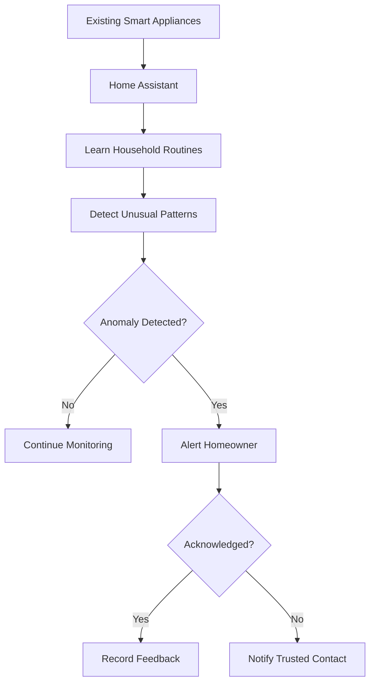

# HiveMind AI

**HiveMind AI turns the lights, fans, and appliances already in your home into a collective behavioral security network, with zero additional sensors. It learns your household's routines, detects unusual activity in seconds, and escalates alerts to trusted family members.**

HiveMind AI is a proposed extension to [Home Assistant Core](https://github.com/home-assistant/core) that treats every connected appliance as part of a single, coordinated intelligence: individually simple, collectively aware.

> **Status:** Proposal / prototype stage. Impact context is drawn from published burglary statistics; HiveMind AI figures are design targets pending validation.

---

## Impact at a Glance

| | |
|---:|:---|
| **0** | additional sensors, cameras, or security hardware required |
| **≥ 90%** | target detection recall on defined test anomalies |
| **≤ 5 s** | target alert delivery time under tested conditions |
| **24 / 7** | continuous, passive behavioral monitoring |
| **5** | automated stages: Learn, Detect, Alert, Escalate, Adapt |
| **2 tiers** | alerting: homeowner first, trusted contact on no response |

## The Problem in Numbers

Home security remains underused, and burglary remains costly and frequent.

| Statistic | Figure |
|---|---:|
| Burglaries reported to the FBI in the U.S. in 2022 | **847,522** |
| Average loss per home burglary (SafeWise) | **≈ $2,661** |
| Burglars who say they would choose another target if an alarm were present | **≈ 60%** |
| Burglaries that are spur-of-the-moment rather than planned | **41%** |
| Increase in burglary likelihood for homes without a security system (widely cited industry figure) | **≈ 300%** |
| Households estimated to have no security system | **roughly half or more, depending on the survey** |

*Sources: FBI Crime Data (2022) as compiled by Zosi Technologies; SafeWise; Alarms.org; Zebra and TechJury burglary statistics summaries. Industry-compiled figures vary by survey and year and should be verified against primary sources before formal citation.*

The gap is clear: most homes lack dedicated security, yet most homes already contain connected appliances producing behavioral data every day.

## Overview

Conventional security depends on dedicated cameras, motion detectors, and door sensors, each adding cost, installation effort, and maintenance. Meanwhile, the lights and fans already in the home generate a continuous record of how the household lives, and that record is almost never used for protection.

HiveMind AI treats that record as a security signal. Normal routines become a baseline, and meaningful departures from that baseline become early warnings.

## How It Works

| Stage | Capability |
|---|---|
| **Learn** | Builds a statistical model of when and how lights, fans, and other connected appliances are normally used. |
| **Detect** | Flags unusual switching, unexpected operating hours, and abnormal combinations of device activity. |
| **Alert** | Notifies the homeowner with a clear explanation of what deviated and why. |
| **Escalate** | Contacts a designated family member or trusted contact if a high-priority alert goes unanswered. |
| **Adapt** | Uses homeowner feedback to refine detection and continuously reduce false alarms. |

## Why HiveMind AI Is Different

| Conventional Security | HiveMind AI |
|---|---|
| Requires purchasing and installing dedicated devices | Uses appliances already in the home |
| Detects a single event, such as a door opening | Detects deviations from learned household behavior |
| Alerts without context | Explains what changed and why it was flagged |
| Fixed rules | Adapts from homeowner feedback |
| Alert ends with the homeowner | Escalates automatically to a trusted contact |

HiveMind AI introduces **behavioral threat awareness without dedicated security sensors**, a new capability category within the smart-home ecosystem.

## Expected Impact

- **Earlier awareness:** Surfaces suspicious appliance activity that would otherwise go unnoticed.
- **Faster response:** Reaches the homeowner and family within seconds of detection.
- **Lower barrier to entry:** Extends monitoring to households that cannot or will not install additional hardware.
- **Higher return on existing devices:** Converts routine appliance data into actionable security intelligence.
- **Deterrence-aligned design:** Supports the layered, early-warning approach that published burglary research associates with reduced risk.

## Evaluation Targets

Initial prototype targets, to be validated through controlled testing.

| Metric | Target |
|---|---:|
| Detection recall on defined test anomalies | ≥ 90% |
| Alert delivery latency under tested conditions | ≤ 5 seconds |
| Additional security sensors required | 0 |
| False-alert rate | Measured and minimized |
| Real-world incident reduction | To be established through field studies |

## Technology Stack

| Component | Purpose |
|---|---|
| Home Assistant Core | Device events and integrations |
| Python | Detection and alert-management logic |
| Statistical anomaly detection | Routine learning and deviation identification |
| Home Assistant notifications | Alerting and escalation |
| Pytest | Validation and reliability testing |

## Design Principles

- **Signal, not proof:** An unusual pattern is a warning indicator, not evidence of a crime.
- **Explainability:** Every alert states its reasoning.
- **Privacy by design:** Household data is handled with minimal exposure.
- **Complementary role:** Designed to strengthen, not replace, conventional security systems.

## Vision

To make every connected home more security-aware by giving its existing appliances a new purpose: helping families notice the unusual before it goes unnoticed.
